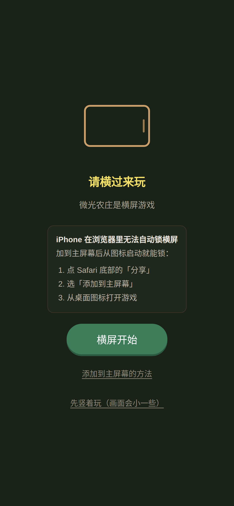
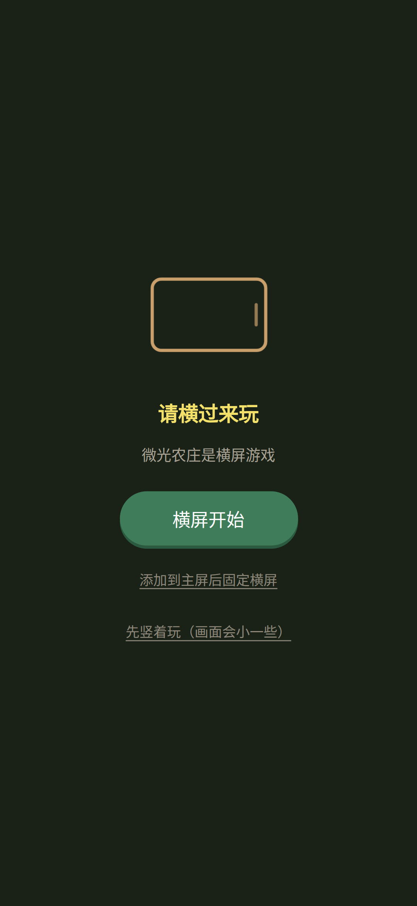
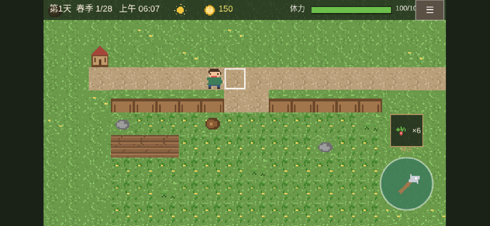

# 微光农庄 Vale Farm

原创像素风农场生活模拟页游 —— 手机横屏、纯前端、可离线、可静态部署。

玩法核心循环：**锄地 → 播种 → 浇水 → 收获 → 出售 → 买种 → 再种**，压力来自时间、体力与季节，而非战斗。

> 全部美术与音效由脚本程序化生成，不含任何第三方游戏的素材、名称、角色、音乐或文本。

**线上地址**：<https://a3aec251faf00b52f.app.workbuddy.host>（当前 v0.4.2 / build 19）

**文档导航**（都在 [`dev-docs/`](dev-docs/)，接手开发请从第一份读起）：

| 文档 | 内容 |
|---|---|
| [开发交接手册](dev-docs/DEV_HANDOVER.md) | 架构、必须遵守的约定、踩坑清单、发版流程、技术债 |
| [游戏设定](dev-docs/GAME_DESIGN.md) | 作物 / 经济 / 体力 / NPC 数值，改平衡先看这份 |
| [部署到 GitHub Pages](dev-docs/GITHUB_PAGES.md) | 一次性配置与每次更新步骤 |

| iPhone 竖屏（无全屏 API） | Android 竖屏（可安装） | 横屏 → 直接进游戏 |
|---|---|---|
|  |  |  |

## 玩法速览

| 系统 | 说明 |
|---|---|
| 农田 | 12×10 可耕地，初始杂草丛生，需清理杂草/石头/树桩 |
| 作物 | 四季萝卜（四季·3天）、糖荚豌豆（春秋·4天）、金穗玉米（夏秋·5天）、灯笼南瓜（秋·6天） |
| 状态机 | 已播种 → 生长中 → 缺水停滞 → 成熟 → 过季枯萎；浇水后次日推进一阶段，雨天自动补水 |
| 品质 | 从未缺水 → 金星/银星概率高；售价 普通 ×1 / 银星 ×1.5 / 金星 ×2 |
| 日循环 | 每天 6:00 起床，约 7 分钟一个白天；凌晨 2:00 强制昏睡；体力耗尽当场昏倒 |
| 昏倒惩罚 | 次日体力减半、丢失 50 金币 |
| 季节 | 28 天一季，过季未成熟作物枯萎（成熟的可以慢慢收） |
| 商店 | 9:00–22:00 营业，按季节卖种、收购作物、出售两件工具升级（铜洒水壶 3 格浇水 / 铜锄头 2 格开垦） |
| 出货箱 | 农场门口（木箱）随时快速出售背包里的全部作物 |
| NPC 米拉 | 固定站位，每日对话 +2 好感；送礼 +30，投其所好（豌豆）+80；好感 100 送种子、300 送金币 |
| 操作 | 左半屏拖动 = 虚拟摇杆；右下大按钮 = 智能动作（按面朝格子自动识别锄/种/浇/收/清/对话/商店/睡觉）；右下上方 = 种子槽（点按切换） |

## 快速开始

```bash
npm install
npm run assets   # 重新生成像素美术（可选，仓库里已带生成好的资源）
npm run dev      # 开发：http://localhost:5173
```

手机测试：`npm run dev -- --host` 后用手机访问局域网地址（需 https 或 localhost 才能注册 SW）。

## 构建与部署

```bash
npm run build    # 产物直接落在 docs/，纯静态
npm run preview  # 本地预览构建产物：http://localhost:4173
npm run package  # 打一个包：源码 + docs/（可部署产物）放一起
```

**产物目录就是 `docs/`，不另开 `dist/`。** 这样做的好处是仓库只有一份「源码 + 可部署物」，
GitHub Pages 直接把发布源设成 `/docs` 即可 —— 不用 `gh-pages` 分支、不用 Actions、不用手动拷文件。

- GitHub Pages：Settings → Pages → Source 选 `Deploy from a branch`，分支 `main`，目录 **`/docs`**
- Nginx：`root /var/www/vale-farm-docs;`（或 `alias` 挂到子路径）
- 注意：PWA（安装、离线）要求 **https 或 localhost**；`file://` 双击 `docs/index.html` 也能玩，只是不注册 SW

### 目录分工：产物归 docs/，文档归 dev-docs/

| 目录 | 内容 | 谁在动它 |
|---|---|---|
| `docs/` | 纯构建产物，GitHub Pages 发布源 | 每次 `npm run build` **整个清空重建** |
| `dev-docs/` | 手写文档（交接手册 / 游戏设定 / 部署说明） | 人手动维护，构建不会碰 |

`docs/` 这个名字是 Pages 的硬约束 —— "Deploy from a branch" 只接受 `/` 或 `/docs`，
不能改成别的名字。既然 `docs/` 里只剩产物，`tools/build.mjs` 就直接整目录删了重建，
不再需要"按清单精细清理"那套逻辑（不会残留旧 hash 资源）。

`public/.nojekyll` 会被拷进 `docs/`，缺了它 Pages 会走 Jekyll，忽略 `_`/`.` 开头的文件。

### 打包策略

```bash
npm run package
# → ../微光农庄-v0.4.2-build19.zip（源码 + docs/ + dev-docs/ 一体）
```

包里是整份仓库（排除 `node_modules` 与 `.git`），解压后既是能 `npm install && npm run build`
的源码，也能直接把 `docs/` 丢给 Pages；`dev-docs/` 里的文档随包带走，接手人开箱可读。脚本会校验 `docs/version.json` 的构建号与源码一致，
避免把上一次的产物打进包。

### 版本发布

```bash
node tools/stamp.js --bump minor --note "本次改了什么"
```

`public/version.json` 是版本信息的**唯一数据源**；脚本会把构建号注入 `sw.js` 的 `BUILD` 并回读校验。发版顺序永远是：改代码 → 测试全绿 → 再 stamp。

## 测试

```bash
npm run test        # Vitest 单测（作物状态机 / 经济 / 存档 normalize / NPC）
npm run test:e2e    # Playwright e2e（需要先 npm run build）

node tools/live-check.mjs [URL]   # 线上冒烟：默认打已部署地址
```

`tools/live-check.mjs` 是**发布后必跑**的一步，补 e2e 补不到的地方：e2e 跑本地 preview，而真机是 dpr=2/3。它对 6 种视口各开一个真触摸上下文，依次「收起建议卡片 → 点 ✕ 关晨报 → 走到 NPC 面前点互动键」，逐项断言：

| 检查 | 说明 |
|---|---|
| `panelCss` | 面板尺寸 == `min(640, 屏宽-24) × min(360, 屏高-40)`（dpr 不该让它缩水） |
| `closedByX` | ✕ 一次点中就关 |
| `actOpens` | 互动键点开对话 |
| `noScroll` | 页面不出现滚动条 |
| `joyLeftBottom` / `actRightBottom` | 摇杆左下、互动键右下 |
| `noErrors` | 0 条 pageerror |

另加一条「运行中 390×844 → 844×390 旋转，不刷新」，验证画布与相机即时跟随。全部通过时退出码 0，可直接接 CI。

e2e 覆盖：页面加载 0 JS 错误、种—浇—收—买全流程、**存档写入→刷新→逐字段还在（含嵌套）**、断网刷新可用、深层子目录部署 0 条 404；触控面板回归（背景拖动不移动、✕ 一次关闭、**动作键点一下就开且抬手不关**、**☰ 可开系统面板**、关闭后摇杆恢复）；竖屏提示条回归（**卡片外触摸直达画布**、点「横屏全屏」真的发了全屏+锁屏请求、全屏被拒也不影响游戏、**iOS 不出现点不动的按钮**、**独立模式下隐藏假按钮**、点「就这么玩」后转一圈也不复弹）；**视口自适应回归（6 种比例：铺满 + 地块方形 + 摇杆左下 / 动作键右下 + 光圈不越界，外加运行中旋转不刷新）**；**面板按 CSS 尺寸撑开且 ✕ 可点（dpr=2 / dpr=3 各一条）**。

单测里 `tests/unit/layout.test.ts` 专门钉住「画布内部分辨率 = CSS×dpr」「可见世界宽高比 = 屏幕宽高比」「zoom 取 max 而非 min」这几条不变量 —— 这层出错时肉眼可见但代码看着都对。

### 屏幕适配（`src/layout.ts` + `UIScene`）

目标是**任何比例的屏幕都铺满、都能玩**：横屏、竖屏、iPad、折叠屏外屏，一律没有黑边，地块永远是正方形。

做法是「画布铺满 + 相机 zoom 反补」：

| 环节 | 做法 |
|---|---|
| 画布 | `Phaser.Scale.NONE` + CSS `width/height: 100%`；内部分辨率 = **CSS × 真实 dpr（不封顶）** |
| 相机 zoom | 横屏 `max(屏高/450, 屏宽/800)`，竖屏 `屏高/844` |
| 结果 | zoom 只改变「看得多/看得少」，1 world px 恒等于 `zoom` 个 CSS px → **地块不变形** |
| 边界 | 相机 bounds 向四周外扩半屏 + 地图外圈多铺 8 格草地，杜绝露出底色 |
| 转屏 | `visualViewport`/`resize` → rAF 合并 → `setGameSize` → UI 场景 60ms 防抖后整棵重建 |

**UIScene 的相机是这套里最容易翻车的一处**，三条约束必须同时满足，少一条画面就废：

```ts
cam.setOrigin(0, 0);                                   // ① 否则 zoom≠1 时平移项 = w*0.5*(1-zoom)，UI 被推走
cam.setZoom(1);                                        // ② 同上
cam.setViewport(0, 0, scale.width, scale.height);      // ③ WebGL 用 cam.width/height 做 scissor 裁剪
```

原因是 Phaser 源码里：

- `WebGLRenderer.preRenderCamera` → `pushScissor(cam.x, cam.y, cam.width, cam.height)`，**`cam.width` 必须是整块画布**，改小就只画出左上角 1/dpr 一块；
- `Camera.preRender` → `matrix.applyITRS(w*originX, ..., zoom) · translate(-w*originX, ...)`，`translate` 是「先乘 scale 再平移」，所以平移项恒为 `e = w*originX*(1-zoom)`；`originX` 默认 0.5，zoom=3 时 `e = -w`，整块 UI 被推到屏幕外。
- 用负 `scroll` 硬拗偏移能骗过渲染，但 `getWorldPoint` 会算反（实测点 (422,334) 解出 -703），**输入全废**。

所以 UI 坐标统一用**画布像素**；尺寸常量仍按 CSS 像素书写（390 / 844 这种数字好读好调），落点时乘 `uiDpr`（`this.DP`）。

#### 单位约定：谁乘 dpr，只能有一处说了算

这一条是 0.4.0 上线后真机才暴露的问题（0.4.1 修复）：坐标系换成「UI 单位 = 画布像素」时，`widgets.ts` 里的面板尺寸常量忘了乘 dpr，于是 dpr=3 的手机上面板只有 `640/3 ≈ 213` CSS px、✕ 按钮宽 16px，**看着是"面板没撑开"，实际是手指根本点不中**。

现在统一成一条规则，别再破例：

> **调用方一律写 CSS 像素，`src/ui/widgets.ts` 内部统一乘 `uiScale(scene)`。**

- `textButton(x, y, w, h, ...)`、`label(x, y, ...)`、`makePanel()` 收的都是 CSS 值；
- `Panel.w / Panel.h` 对外也是 CSS 值（面板排版代码直接拿它算坐标，不用再折算）；
- `uiScale(scene) = scene.scale.width / window.innerWidth`，与 `UIScene.uiDpr` 同源（后者直接调用它）。

`UIScene` 里 `buildHud / buildButtons` 是自己乘 `S` 的，所以**传给 `textButton` 前要除回去**，例如 ☰ 按钮：

```ts
const sysW = Phaser.Math.Clamp(shortCss * 0.13, 42, 56);          // CSS 值，不乘 S
textButton(this, (W - pad * 0.6 - sysW * S / 2) / S, (pad * 0.5 + sysH * S / 2) / S, sysW, sysH, '☰', ...);
```

`tests/e2e/smoke.spec.ts` 里「面板尺寸按 CSS 像素撑开且 ✕ 可点（dpr=2 / dpr=3）」两条专门钉这件事——**只测 dpr=1 的用例永远抓不到这个 bug**。

#### 面板内容自适应缩放

面板内部排版（按钮 x=±170、±270 这类坐标）全部按 **640 宽的横屏面板**设计；竖屏面板只有 ~320–370 宽，硬塞会伸出左右边（0.4.1 竖屏「系统」面板翻车，见图）。修法在 `makePanel` 内一处搞定：

```ts
const bodyScale = Math.min(1, PANEL_W / (640 * S));
body.setScale(bodyScale);
```

内容整体等比缩放，坐标、字号、命中区一起缩，触摸检测随 transform 自动正确。横屏 `bodyScale = 1` 不受影响。`modal.spec.ts` 里「竖屏 / 折叠屏：系统面板内容不超出面板边界」两条钉住它。

#### 安全区域（刘海 / 灵动岛 / Home 指示条）

画布 `viewport-fit=cover` 铺满全屏，所以**必须自己躲开安全区**，否则 iOS 上顶部整条 HUD 会被灵动岛吃掉（不是遮一半，是什么都看不到）。

三条铁律：

1. **不能用 padding 挤 `#game`**（旧版写过 `#game { padding-bottom: env(safe-area-inset-bottom) }`）。画布被顶小 34px，可 Phaser 的内部分辨率仍按视口算 → CSS 纵向拉伸，画面糊、触摸坐标整体偏移。`env()` 的值只在 `viewport-fit=cover` 时有意义。
2. **不能让 zoom 去扣安全区**。zoom 按「扣掉安全区的高度」算，等于把地图整体缩小，屏幕底部那块世界白白损失。正确姿势是 **zoom 不变、视口内缩**：`cam.setViewport(left, top, w-left-right, h-top-bottom)`（见 `GameScene.applyCameraZoom`）。
3. **UI 落点一律从 `safe` 起算**。`UIScene` 里有 `safe`（CSS 像素），`buildHud` 的内容从 `safe.top + padY` 起、`buildButtons` 的底部基线取 `max(pad, safeBottom, safe.bottom*S + pad/2)`、☰ 落在 `safe.top + hudH/2`。
4. **让开安全区还不够，内容自己要有内边距**。`env()` 在 iOS 上常比真实遮挡少几像素（状态栏 translucent 层叠），HUD 躲开了、文字却贴着 HUD 上沿画 → 0.4.2 的「能点但看不清」。所以 HUD 高度是**按内容行数实算**的（`lines * lineH + padY * 2`，`padY = 9`），文字统一 `origin(0,0)` 从 `ty` 起排，不再用 `fontSize × 0.62` 去猜垂直居中。

**底部黑带**是另一件事：`html/body { height: 100% }` 在 iOS 取的是 layout viewport，地址栏/状态栏一收放就差一截。修法两层：`height: 100dvh` + `main.ts` 把 `visualViewport.height` 写进 `--app-h`；同时 `computeLayout()` 改成读 `#game` 的 `getBoundingClientRect()`，保证「内部分辨率」和「CSS 显示尺寸」永远同源。

读法在 `src/layout.ts`：`readSafeInsets()` 挂一个探针元素读四条边的 computed padding；`effectiveSafeInsets()` 再夹一道上限 `min(80px, 视口高 × 16%)`（横屏半屏 / 分屏时视口只有 200px，不夹会把 UI 挤没）。

**为什么不缓存**：转屏到底"`resize` 先到"还是"`env()` 先生效"，各浏览器没保证。`UIScene.update()` 每帧读一次、值变了才重建 HUD/按钮，代价只是一次 `getComputedStyle`。

e2e 怎么测：headless Chromium 没有刘海，`env()` 恒为 0，所以 `safe-area.spec.ts` 用 `window.__valeSafeInsets = { top: 59, bottom: 34 }` 注入真机数值再断言（`currentSafeInsets()` 优先取注入值）。

#### iOS PWA（添加到主屏）的两个独立坑

**真机实测（build 15 回传，iPhone 393×852）**：`screen.height` 852、`env(t/b)` 59/34、`innerHeight` 793。
`852 - 59 = 793` ✅，`852 - 59 - 34 = 759` ❌ —— 说明 **只有顶部被系统让开了，底部没有**。
所以 `env(top)` 不能再叠加（叠加就是"顶部深色带"），`env(bottom)` 必须照旧让。

**但"让"有两种含义，必须分开算（build 18 的教训）**：

| 谁 | 用什么 | top 怎么处理 | 为什么 |
|---|---|---|---|
| 相机取景（`GameScene.safePx`） | `contentInsets()` | 视口已让开 → 归 0 | 相机是在可视区里**再切一块**取景；那 59px 本来就不在可视区、也没被挡住，再切就是把地图白裁一条 |
| UI 覆盖层（`UIScene`） | `uiInsets()` | **永远不让出**，保持 `env(top)`=59 | HUD 是**盖**上去的。`black-translucent` 让状态栏白字浮在网页上，HUD 底色必须铺到 y=0 盖住它，文字排到 59 之下 |

build 17 把两者混用（UI 也走 `contentInsets`），`safe.top` 被归零 → HUD 底色只到 45px，
状态栏那排白字正好落在里面 → 用户原话「顶部状态栏看都看不到了」。

底部那条"黑条 + 空白"同理是两件事叠加：`--app-h` 曾被写成 `visualViewport.height`=793，
但屏幕 852，页面只画到 793，**下方 59px 露出 `html` 背景色**。现在 `measureAppHeight()`
只认 `innerHeight`（系统已扣状态栏的"可视区"），页面铺满整屏，由 HUD 盖住状态栏、相机取景避让；
`#game` 另加 `background: #1a2218` 兜住 `setGameSize` 慢一帧的空档（原本会露 Phaser 的 `#080808`）。

这两个是 0.4.2 用户实拍「图二 PWA 应用模式不行」的真凶，**普通浏览器里都看不出来**，只有在独立窗口里才复现：

| 现象 | 根因 | 修法 |
|---|---|---|
| 顶部露出深色带，HUD 被压到状态栏下 | ① iOS 独立窗口里 `viewport-fit=cover` 常不生效 → `env(safe-area-inset-*)` **全为 0**；② `black-translucent` 又让内容铺到状态栏下 | `layout.ts` 的 `currentSafeInsets()`：`env()` 四边全 0 且「iOS + 独立模式」时用 `IOS_PWA_FALLBACK = { top: 59, bottom: 34 }` 顶上。读到任何一条边就认为 env 工作，不叠经验值 |
| 上下各一条黑带（高度偏小） | 冷启动瞬间 `visualViewport.height` 还是旧值/0；早先只写一次 `--app-h`，页面就**定格在偏小高度再也不重测** | `main.ts` 的 `measureAppHeight()` 返回 `null` 表示"没量准，继续等"，`settleAppHeight()` 在启动后逐帧补测 ~1.2 秒（72 帧），量到变化才重排 |

两处环境判断的边界：

- `isIosDevice()` 对 iPadOS 13+（UA 伪装成 `Macintosh`）靠 `maxTouchPoints > 1` 区分，真 Mac 恒为 0 —— 单测里桌面 UA 用例**必须显式传 `maxTouchPoints: 0`**，否则测试桩默认值会把 Mac 判成 iPad。
- `isStandaloneApp()` 两个条件都要问：`navigator.standalone` 只有 iOS 有值，`(display-mode: standalone)` 在 iOS 上不可靠。
- `manifest.json` 的 `display` 必须是 `standalone`（iOS 不认 `fullscreen`），`display_override` 只对 Chromium 系生效。

**真机排查工具（两条路）**：① 游戏内 ☰ → 系统 → 环境诊断 —— **PWA 里唯一可行的入口**（独立窗口没有地址栏，`diag.html` 的网址输不进去），显示浏览器环境 + 游戏实际排版结果，右上角 ⧉ 一键复制；② 线上打开 `https://<域名>/diag.html`（仅限浏览器标签页）。这页用和游戏**完全相同**的方式探测环境，逐项列出 `innerHeight` / `visualViewport` / `env()` / `screen` / dpr / `navigator.standalone`，底部还有红色（顶）/ 绿色（底）两条标记条，直接看得到状态栏和 Home 条各占多少。数值对不上时据实改 `IOS_PWA_FALLBACK` 即可。该页在 `sw.js` 里走 `networkFirst`（`NETWORK_FIRST` 正则），保证永远是服务端最新的一份 —— 其它资源都是 cacheFirst，诊断页要是也被缓存钉死就没法查了。


### 竖屏提示条（`src/orientation.ts`）

竖屏**本来就能玩**，`#rotate-tip` 只是一张浮在**屏幕中央**的建议卡片，不是遮罩（以前贴顶，正好压在灵动岛下面，按钮点不到）：

- `#rotate-tip { pointer-events: none }` —— 卡片以外的地方照常点得到游戏（这是"竖屏也能玩"的唯一保证）
- `#rotate-card { pointer-events: auto }` —— 卡片自己的按钮要能按

按能力探测决定卡片上出现什么（`syncActions()`），原则是**不摆永远点不动的按钮**：

| 环境 | 卡片上给什么 |
|---|---|
| 普通浏览器 | 「横屏全屏」（手势内同步请求全屏 + 锁横屏）+ 「就这么玩」 |
| iOS Safari 标签页 | 同上 + **添加到主屏幕的三步图文**（iOS 无全屏 API，这是唯一可能锁横屏的路） |
| Chromium 系（有 `beforeinstallprompt`） | 「横屏全屏」+ **添加到主屏后固定横屏**（真能弹安装框）+ 「就这么玩」 |
| 已装成 PWA | 只留提示，不摆「横屏全屏」（横竖由 manifest 决定），再讲安装步骤没意义 |

两个易错点：

- **必须同步发起**：`await` 任何东西都会丢掉用户手势上下文，全屏/锁屏会被拒。`requestLandscape()` 是同步函数，成败靠 `.then/.catch`。
- **不要用 `scale.orientation: 'landscape'`**：它只决定画布取宽高基准，**不能旋转设备**；也不要 `transform: rotate(90deg)` —— 视觉转了、触摸坐标不跟。

### 版本历史

| 版本 | build | 内容 |
|---|---|---|
| 0.1.0 | 1 | 首个可玩版本：种植循环、日循环、商店、NPC、存档、PWA |
| 0.1.1 | 2 | 触控三处根因修复（按钮命中区偏移 / 图标压层级 / `pointer.id` 复用） |
| 0.2.0 | 3 | 横屏分层策略：手势内全屏 + 锁横屏，竖屏遮罩兜底；晨报按钮改为「横屏开始」 |
| 0.3.0 | 4 | iPhone 降级体验：按能力探测换按钮，PWA 安装引导，新增「先竖着玩」出口 |
| 0.4.0 | 5–9 | **全屏自适应 + 竖屏可玩**：Scale.NONE 铺满 + 相机 zoom 反补（地块永不变形）；摇杆固定左下、互动键右下、种子槽居中，尺寸按屏幕短边算；竖屏改为不挡触摸的建议卡片 |
| 0.4.1 | 10 | **修 dpr 单位混用**：面板与按钮在 dpr>1 的机上缩水到 1/dpr、✕ 点不中（见上节「单位约定」）；`tools/stamp.js` 修 `--set` 被 `--build` 抢占、`--note` 漏写两处 |
| 0.4.2 | 11–18 | **顶部 HUD 可读性 + 铺满 + iOS PWA**：HUD 高度改为按内容实算并留 `padY=9` 内边距（修「能点但看不清」）；`100dvh` + `--app-h` + 画布尺寸同源（修底部黑带）；☰ 改居中对话框；**新增 iOS 独立模式 env() 失效兜底、冷启动高度补测**（修 PWA 图二的深色带与上下黑带）；manifest 改 `standalone`；build 15 起**诊断做进游戏内**（☰ → 系统 → 环境诊断，PWA 无地址栏输不了 diag.html 的网址）；build 16 **按顶部实测判据去掉重复让出**（修深色带），提示框/对话框改为按「HUD 下可用区」垂直居中；build 17 更新提示条改为屏幕中部居中（触控目标 ≥44px）；**build 18 把 UI 与相机的安全区口径拆开**（`uiInsets` vs `contentInsets`）——HUD 底色盖住状态栏、文字排其下，`--app-h` 改认 `innerHeight` 让页面铺满整屏，`#game` 加兜底色，消除「状态栏看不到 + 底部黑条空白」 |


### 触控层的三个坑（都踩过，已修）

都是「视觉对、点击不对」的问题，排查时优先怀疑层级与事件时序：

1. **Container 误用 `setSize`**：`setSize` 会把 `displayOrigin` 设成尺寸的一半，而 Container 按 0 原点渲染，命中区整体偏移 (-w/2, -h/2)，按钮右下 1/4 失灵。修法：容器只 `setInteractive(自定义矩形)`，不 `setSize`（见 `src/ui/widgets.ts`）。
2. **图标层级压住别的按钮**：动作键图标用了 `buttons+1`，它和 ☰ 的命中区在右上角重叠，图标赢了点击 → 点菜单变成做动作。修法：图标与底图同层（靠 displayList 顺序压上去），需要盖住别人的按钮显式提到 `buttons+2`。
3. **用 `pointer.id` 判断"手指是否是新按下的"**：Phaser 的触屏与合成鼠标复用同一组 Pointer 实例，id 会互相顶替，抬手时会把"另一根新手指"当成"旧手指"。修法：用 `pointerdown` 的**事件对象**做 key（每个事件都是新对象），见 `makePanel` 的 `preDown`。

## 存档说明

- **自动存档**：睡觉结算后、每 20 秒、切后台时（IndexedDB；隐私模式下自动降级 localStorage）
- **导出**：右上 ☰ 系统菜单 → 导出存档（JSON 文件，含版本头）
- **导入**：同一菜单 → 导入存档；裸 World JSON 也兼容
- **结构演进**：`World` 每加一个字段必须同步登记进 `src/core/save.ts` 的 `normalizeWorld`（逐字段重建，防脏数据也防漏字段）；结构不兼容时把 `config.ts` 的 `SAVE_FMT` +1 并在 `migrateFrom` 里加一档迁移
- 设置（音效开关等）存 localStorage，与存档分离

## 项目结构

```
tools/gen_assets.py    像素美术生成器（图集 / PWA 图标 / iOS 启动图）
tools/stamp.js         版本发布脚本（version.json 单一数据源）
tools/live-check.mjs   发布后线上冒烟（真触摸 + 多视口，见「测试」节）
tools/verify-sw.mjs    校验 SW 缓存名带内容哈希、旧缓存被清（见「Service Worker」节）
src/core/              纯逻辑：状态机、经济、日循环、存档（可脱离 Phaser 单测）
src/scenes/            Boot / Game / UI 三个 Phaser 场景
src/ui/                摇杆、按钮、面板小部件
src/pwa.ts             PWA 引导层（与玩法解耦，删掉不影响游戏）
public/sw.js           Service Worker（cacheFirst、逐资源预缓存、按前缀清缓存；diag.html 走 networkFirst）
public/diag.html       真机环境诊断页（仅浏览器标签页可达；PWA 用游戏内诊断入口）
src/dev/envDiag.ts     游戏内环境诊断的数据采集（☰ → 系统 → 环境诊断）
docs/                  构建产物（GitHub Pages 发布源），每次 build 整个清空重建
dev-docs/              人写的文档，build 不会碰
  DEV_HANDOVER.md      开发交接手册（架构 / 约定 / 踩坑 / 发版 / 技术债）
  GAME_DESIGN.md       游戏设定速查：作物/经济/体力/NPC 数值、地图坐标
  GITHUB_PAGES.md      Pages 部署步骤
tools/build.mjs        构建入口：清空 docs/ → vite build → 注入 SW 清单
tools/package.mjs      打包：源码 + docs/ 合成一个 zip
```

## PWA / 离线要点

- 导航与静态资源一律 **cacheFirst**，更新靠后台静默拉新 + 切前台比对 `version.json`
- 发现新版本只弹提示条，**绝不自动 reload**（用户可能正在玩）
- 预缓存逐个 `cache.add` + catch，单个资源 404 不会连坐整个 install
- 清缓存只清 `vale-farm-` 前缀，不误删同域其他应用

## 已知边界（MVP）

不做矿洞、钓鱼、战斗、动物、结婚、多人联机与复杂剧情。数值平衡（金币/体力/物价）集中在 `src/core/config.ts` 与 `src/core/data.ts`，调平衡只改这两处。
