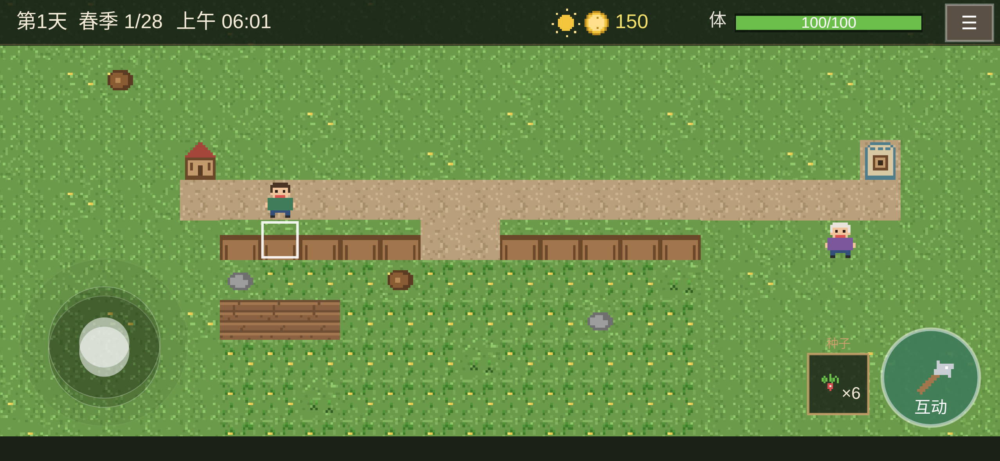
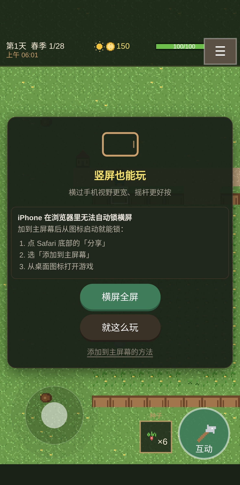

# 微光农庄 Vale Farm

原创像素风农场生活模拟页游。手机优先，纯前端、无后端、可离线，可静态部署。

[在线试玩](https://zhihaofans.github.io/ValeFarm/) · [源码](https://github.com/zhihaofans/ValeFarm) · [开发文档](dev-docs/DEV_HANDOVER.md) · [更新记录](CHANGELOG.md)

| 横屏 | 竖屏 |
|---|---|
|  |  |

## 玩法

- **12×10 农田**：清理杂草 / 石头 / 树桩 → 锄地 → 播种 → 浇水 → 收获 → 出售 → 买种。
- **四季与天气**：28 天一季，雨天自动补水，过季未成熟作物枯萎。
- **作物与品质**：四季萝卜、糖荚豌豆、金穗玉米、灯笼南瓜、红莓草莓、蜜心红薯；普通 / 银星 / 金星售价 ×1 / ×1.5 / ×2。
- **日循环与体力**：6:00 起床，约 7 分钟一个白天；凌晨 2:00 强制睡觉，体力耗尽会昏倒。
- **商店与 NPC**：按季节卖种、收购作物、工具升级；米拉的好感、送礼与里程碑奖励。
- **林区与制作**：东侧林区砍树获得木头，物品栏分类查看；制作台可做木镐等工具，矿洞后续开放。
- **手机操作**：左下摇杆、右下智能互动键、**快捷栏**（点开切换种子/道具）、☰ 系统菜单；横竖屏都能玩，iPhone 15 Pro 横屏会自动让开左右灵动岛/圆角。
- **存档与 PWA**：IndexedDB 自动存档，支持 JSON 导出/导入；可安装、可离线。

全部美术与音效由脚本程序化生成，不含第三方游戏素材。

## 快速开始

```bash
npm install
npm run dev        # http://localhost:5173
```

手机同局域网调试：`npm run dev -- --host`（注册 Service Worker 需要 https 或 localhost）。

美术已随仓库生成；改美术时运行 `npm run assets`（需要 Python + Pillow）。

## 构建与测试

```bash
npm run build      # 类型检查 + 构建到 docs/
npm run preview    # 预览 docs/（:4173）
npm test           # Vitest 单测
npm run test:e2e   # Playwright e2e；必须先 npm run build
npm run package    # 源码 + docs/ 打包
```

e2e 跑的是 `docs/` 里的构建产物，不是 `src/`。首次运行 Playwright 需要 Chrome：

```bash
npx playwright install chrome
```

发布后线上冒烟（URL 显式传入，不写入仓库）：

```bash
node tools/live-check.mjs https://example.com/
```

## 部署到 GitHub Pages

- 构建产物在 `docs/`；GitHub Pages 发布源设为 `master` / `/docs`。在线地址见顶部「在线试玩」。
- 产物全部是相对路径（[vite.config.ts](vite.config.ts) 的 `base: './'`），**部署在 `/ValeFarm/` 子路径下不需要改 base**。不要改成 `/ValeFarm/`，那会破坏本地 preview 和其他子路径部署。
- 详细步骤见 [GITHUB_PAGES.md](dev-docs/GITHUB_PAGES.md)。

## 文档

| 文档 | 内容 |
|---|---|
| [开发交接手册](dev-docs/DEV_HANDOVER.md) | 架构、硬约定、踩坑、测试、发版、技术债 |
| [游戏设定](dev-docs/GAME_DESIGN.md) | 作物 / 经济 / 体力 / NPC 数值 |
| [技术细节](dev-docs/TECH_NOTES.md) | 屏幕适配、安全区、PWA、触控坑的推理过程 |
| [更新记录](CHANGELOG.md) | 版本与 build 历史 |
| [GitHub Pages](dev-docs/GITHUB_PAGES.md) | 部署步骤 |

## 目录结构

```text
src/core/       纯逻辑：状态机、经济、日循环、存档（可脱离 Phaser 单测）
src/scenes/     Boot / Game / UI 三个 Phaser 场景
src/ui/         摇杆、按钮、面板小部件
src/layout.ts   屏幕适配
src/pwa.ts      PWA 引导（与玩法解耦）
public/         静态资源、sw.js、manifest
docs/           构建产物（Pages 发布源）
dev-docs/       人写文档
tools/          美术生成、构建、打包、线上冒烟
tests/          单测 + e2e
```

## 技术栈

Phaser 3 + TypeScript + Vite；Vitest 单测 + Playwright e2e；无后端，存档在浏览器本地。

## 已知边界

不做矿洞、钓鱼、战斗、动物、结婚、多人联机与复杂剧情。数值平衡集中在 `src/core/config.ts` 与 `src/core/data.ts`。
